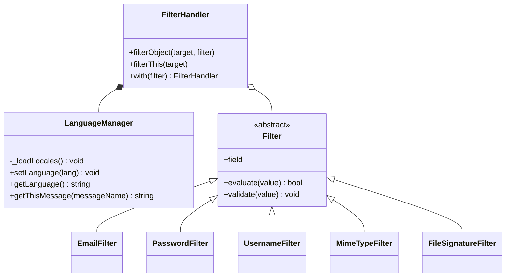

# Biblioteca

Biblioteca de materiales de estudio con roles. Parte de la estructura y el diseño de **SampleVault** (capas separadas, patrón Repository, procedimientos almacenados con mínimo privilegio, frontend sin `innerHTML`) y lo adapta a otro dominio: en lugar de samples de audio, se publican **materiales** (PDF, Word, PowerPoint, Excel, texto e imágenes).

## Roles

| Rol | Qué puede hacer |
|---|---|
| **admin** | Todo: ver y eliminar usuarios, cambiar roles, eliminar cualquier material y también subir materiales. |
| **professor** | Subir material y eliminar el propio. |
| **student** | Consultar y descargar el catálogo (como cliente). |
| *visitante* | Con `PUBLIC_ACCESS=true` puede consultar y descargar sin iniciar sesión. Nunca puede subir ni administrar. |

Todo registro público crea un **student**. Solo un admin puede promover a alguien a professor o admin (el rol nunca se toma del pedido de registro).

## Arquitectura

```text
├── backend/
│   ├── config/          # db.js (pool MariaDB), multerConfig.js, roles.js, paths.js, init.sql, delete.sql
│   ├── controllers/     # Lógica de negocio (auth, materiales, admin)
│   ├── filters/         # Módulo Filter (antes "Validator"): detecta patrones
│   ├── locales/         # Mensajes de los filtros: es.json, en.json
│   ├── middleware/      # JWT, roles, idioma
│   ├── repositories/    # Patrón Repository: único lugar con acceso a datos
│   ├── routes/          # /api/auth, /api/materials, /api/admin y las páginas
│   ├── uploads/         # Archivos físicos (no se sirven como estáticos)
│   ├── utils/           # fileHelper, parseId
│   ├── tests/           # node:test (sin necesidad de MariaDB)
│   ├── app.js           # Construye la app Express
│   └── server.js        # Arranca el servidor
└── frontend/
    ├── css/ html/
    └── js/
        ├── components/        # uiHandlers.js
        ├── frontControllers/  # auth, library, professor, admin
        ├── services/          # apiService.js
        └── utils/             # authHelper.js
```

El backend sirve el frontend como estáticos por comodidad, pero las capas son independientes: el frontend solo habla con `/api`. Para hospedarlo aparte, definir `window.API_URL` antes de cargar `apiService.js` y `CORS_ORIGIN` en el `.env`.

## El módulo Filter

Pasa del diagrama de clases a código así:

| Diagrama | Código |
|---|---|
| `ValidationHandler` | `filters/FilterHandler.js` |
| `validationObject(target, validationObject)` | `filterObject(target, filter)` |
| `validateThis(target)` | `filterThis(target)` |
| `with(validationObject)` | `with(filter)` (devuelve `this`, se encadena) |
| `Email`, `Password` | `EmailFilter`, `PasswordFilter` (más `UsernameFilter`, `MimeTypeFilter`, `FileSignatureFilter`) |
| `evaluate(target): bool` / `validate(target)` | `Filter.evaluate(value)` / `Filter.validate(value)` |
| `LanguageManager` | `filters/LanguageManager.js` (mismos cuatro métodos) |
| composición `ValidationHandler ◆— LanguageManager` | `FilterHandler` crea su propio `LanguageManager` |
| agregación `ValidationHandler ◇— Email/Password` | `with()` agrega filtros a una lista |



**Criterio:** un *Filter* solo responde "¿este valor cumple el patrón?" (formato de email, fortaleza de la contraseña, tipo de archivo). Las reglas de negocio (rol inicial, "un profesor solo borra lo suyo", título obligatorio) viven en los controladores.

Uso:

```js
const handler = new FilterHandler(req.lang)      // 'es' o 'en'
    .with(new UsernameFilter())
    .with(new EmailFilter())
    .with(new PasswordFilter());

const { valid, errors } = handler.filterThis(req.body);
// errors: [{ field: 'email', message: 'El email no tiene un formato válido.' }]
```

Cada filtro conoce su campo (`new EmailFilter('correo')` filtra `target.correo`). El idioma sale del header `Accept-Language`; para sumar uno, agregar `locales/<idioma>.json`.

## Puesta en marcha

Requisitos: Node.js 18 o superior y MariaDB 10.4 o superior.

```bash
# 1. Crear la base, el usuario de la app, las tablas y los datos de prueba
mariadb -u root -p < backend/config/init.sql

# 2. Configurar y arrancar
cd backend
cp .env.example .env        # completar JWT_SECRET con una clave larga y aleatoria
npm install
npm start                   # http://localhost:3000
```

Usuarios de prueba (solo desarrollo, se crean con `init.sql`):

| Email | Contraseña | Rol |
|---|---|---|
| admin@biblioteca.local | Admin1234 | admin |
| profesor@biblioteca.local | Profesor1234 | professor |
| alumno@biblioteca.local | Alumno1234 | student |

Para empezar de cero: `mariadb -u root -p < backend/config/delete.sql` y volver a ejecutar `init.sql`.

Pruebas: `cd backend && npm test`. Cubren los filtros, el `LanguageManager` y la API completa (registro, login, JWT, roles, subida con Multer, descargas, acceso público). Usan repositorios en memoria, así que no hace falta tener MariaDB para correrlas; los procedimientos almacenados de `init.sql` solo se ejercitan con la base real.

## API

| Método y ruta | Quién |
|---|---|
| `POST /api/auth/register` `{username, email, password}` | todos |
| `POST /api/auth/login` `{email, password}` → `{token, role, username}` | todos |
| `GET /api/config` → `{publicAccess}` | todos |
| `GET /api/materials?q=&subject=` | público o cualquier rol (según `PUBLIC_ACCESS`) |
| `GET /api/materials/subjects` | ídem |
| `GET /api/materials/:id` y `/:id/download` | ídem |
| `GET /api/materials/mine` | professor, admin |
| `POST /api/materials` (multipart: `title`, `subject`, `description`, `file`) | professor, admin |
| `DELETE /api/materials/:id` | professor (solo los suyos), admin (cualquiera) |
| `GET /api/admin/users` | admin |
| `PATCH /api/admin/users/:id/role` `{role}` | admin |
| `DELETE /api/admin/users/:id` | admin |

## Seguridad: decisiones tomadas

- **Contraseñas** con BCrypt (costo 10); la clave se limita a 72 bytes porque BCrypt ignora el resto. El login responde igual y tarda lo mismo si el email no existe.
- **JWT** HS256 de 2 horas; se verifica fijando el algoritmo. El servidor no arranca sin `JWT_SECRET`.
- **Archivos:** Multer filtra por tipo MIME y tamaño; el nombre en disco lo genera el servidor (UUID); después se comprueba la **firma real** del contenido contra el MIME declarado y, si no coincide, se borra. Los archivos no se sirven como estáticos: se descargan por la API, siempre como adjunto y con `nosniff`.
- **Base de datos:** el usuario de la app solo tiene `SELECT` y `EXECUTE`; toda escritura pasa por procedimientos almacenados.
- **Interfaz sin `innerHTML`:** los textos del servidor se insertan con `textContent`.

## Diferencias con SampleVault

- Roles `admin / professor / student` en vez de `admin / producer`; un solo rol por usuario (`users.role_id`).
- Login por **email** (el email pasa por `EmailFilter`).
- El módulo de validación pasa a llamarse **Filter**, y el chequeo de tipo de archivo (antes dentro de `multerConfig.js`) pasa a ser `MimeTypeFilter` y `FileSignatureFilter`.
- Los archivos se descargan con control de acceso en lugar de `express.static('/uploads')`.
- Los `DELETE` devuelven `404` cuando el registro no existe (los procedimientos informan `ROW_COUNT()`).
- El backend no filtra mensajes internos de error en las respuestas `500`.
- Un `401` sin token (por ejemplo, credenciales erróneas) ya no cierra la sesión ni recarga la página antes de mostrar el error.

## Límites conocidos

- El token vive en `localStorage`; la interfaz sin `innerHTML` reduce el riesgo de XSS, pero si se necesita más protección, conviene pasar a cookies `HttpOnly`.
- El rol viaja dentro del token: si un admin cambia el rol de alguien, el cambio rige desde su próximo login (o cuando venza el token, a las 2 horas).
- No hay límite de intentos de login (rate limiting); recomendable antes de publicarlo en internet.

Proyecto derivado de SampleVault (Tecnologías Informáticas B, Facultad de Ingeniería, UNMdP). Licencia GNU GPL 3.0 (ver `LICENSE`).
# Bibliotech_proyect
